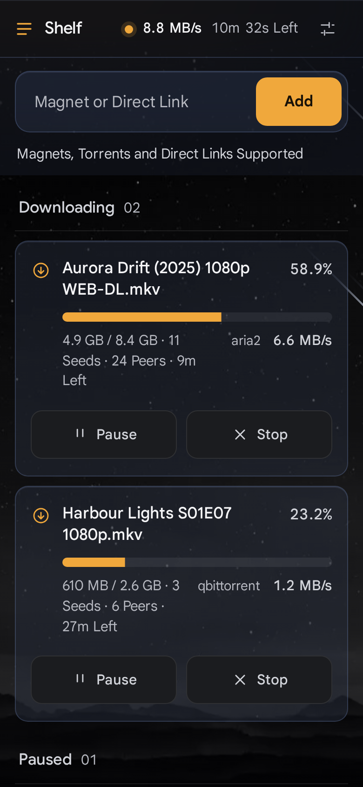
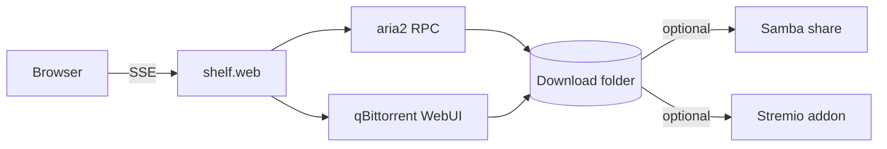

# Shelf

**A download station for a home server.** One page for aria2 and qBittorrent,
one live queue, one guided installer. It sleeps when nobody is looking, so it
costs nothing between visits.

[](tests)
[](pyproject.toml)
[](https://fastapi.tiangolo.com)
[](#requirements)
[](https://github.com/ortiqolabs/shelf/commits/main)
[](https://github.com/ortiqolabs/shelf/stargazers)


## Contents

- [Features](#features)
- [Quick start](#quick-start)
- [Screenshots](#screenshots)
- [Architecture](#architecture)
- [Configuration](#configuration)
- [API](#api)
- [Stremio addon](#stremio-addon)
- [Development](#development)
- [Security](#security)
- [Design](#design)
- [Licence](#licence)

## Features

| | |
|---|---|
| **One queue** | aria2 and qBittorrent transfers in a single list, merged server-side |
| **Paste anything** | Magnets, torrent URLs and plain HTTP links, split automatically |
| **Live updates** | Server-sent events, one snapshot per second, no polling |
| **Real controls** | Pause, resume, stop and delete, with file cleanup inside the download folder only |
| **Settings page** | Download folder, concurrency and speed limit, applied live and persisted |
| **Costs nothing idle** | systemd socket activation; the process exits after 15 idle minutes |
| **Optional Samba** | A read-only share of the download folder, firewall opened when needed |
| **Optional addon** | The same library as a Stremio catalogue on port 7020 |
| **No build step** | Vanilla JS and CSS, self-hosted fonts, zero runtime CDN calls |

## Quick start

On the server, inside the repository:

```bash
sudo ./shelf.sh
```

With a terminal attached, setup asks four questions with safe defaults and shows
a summary before changing anything:

```
Shelf setup  press Enter to accept the default in brackets

  Download folder [/media/Movies_and_Shows]:
  Page port [5000]:
  Share the download folder over Samba (y/n) [y]:
  Install the Stremio addon (y/n) [n]:
  Open firewall ports (y/n) [y]:
```

It then installs aria2 and Python, builds the environment, writes
`~/.config/aria2/aria2.conf`, installs the systemd units, creates the Samba
share, optionally installs the Stremio addon, and opens the firewall when one is
active.

```bash
./shelf.sh --status             # what is running and where
./shelf.sh --start | --stop | --restart
./shelf.sh --logs [--follow]
sudo ./shelf.sh --uninstall     # units and share, keeps files and data
```

### Scripted installs

Any explicit option skips the questions; `--yes` accepts every default.

```bash
sudo ./shelf.sh --yes
sudo ./shelf.sh --with-stremio --dir /srv/media --name Media --write --no-firewall
```

| Option | Meaning |
|---|---|
| `--dir PATH` | download folder |
| `--share PATH`, `--name NAME`, `--write` | Samba share, name and write access |
| `--with-stremio`, `--addon-port`, `--tmdb-key` | install the Stremio addon |
| `--port`, `--idle SECONDS` | page port, idle timeout |
| `--no-samba`, `--no-stremio`, `--no-firewall` | skip a step |
| `--dry-run` | print actions, change nothing |

### Requirements

Linux with systemd, Python 3.11+, aria2, and about 150 MB of disk for the venv.
Tested on Raspberry Pi OS 12 (aarch64) and Arch (x86-64).

## Screenshots

| Queue | Phone |
|---|---|
|  |  |

Generated by `tools/screenshots.py`, which answers `/api/*` with invented demo
data, so a real library never appears in the repository.

## Architecture

```
shelf/
  web.py          routes, event stream, idle watchdog
  qbittorrent.py  optional qBittorrent client, merged into the same queue
  aria2.py        JSON-RPC client, transfer shaping, safe deletes
  settings.py     validation and persistence for the settings page
  config.py       paths, aria2 secret, timers
static/           page, settings page, fonts, wallpaper
stremio-addon/    optional Stremio catalogue addon
tests/            shaping, API, settings and qBittorrent tests
shelf.sh          install, start, stop, status, logs, uninstall
docs/             screenshots
```

Transfers carry a `source` field (`aria2` or `qbittorrent`); qBittorrent ids
are namespaced `qb:<hash>`. Without qBittorrent environment variables the bridge
is inert and the page behaves exactly as an aria2 front end.



## Configuration

| Variable | Default | Meaning |
|---|---|---|
| `SHELF_QB_URL` | unset | qBittorrent WebUI, enables the bridge when set |
| `SHELF_QB_USER` | unset | qBittorrent username |
| `SHELF_QB_PASS` | unset | qBittorrent password |
| `SHELF_IDLE_SECONDS` | `900` | idle time before the page process exits |
| `SHELF_ARIA2_CONF` | `~/.config/aria2/aria2.conf` | aria2 configuration |
| `SHELF_ARIA2_RPC` | `http://127.0.0.1:6800/jsonrpc` | aria2 RPC endpoint |

Secrets live in `.env` beside the repository, which git ignores. `shelf.sh`
creates it only when missing and never overwrites it.

## API

| Method | Path | Purpose |
|---|---|---|
| `GET` | `/api/state` | snapshot with summary, source and qBittorrent health |
| `GET` | `/api/events` | server-sent events, one per second |
| `POST` | `/api/add` | `{"url": "..."}`, spaces split into several links |
| `POST` | `/api/action` | `{"gid": "...", "action": "pause\|resume\|cancel\|delete\|remove"}` |
| `POST` | `/api/all/pause` `/api/all/resume` | every engine at once |
| `GET` `PUT` | `/api/settings` | read or change folder, concurrency, speed limit |

`cancel` and `delete` stop the transfer and remove its files. `remove` clears a
finished entry and deletes leftovers only when the entry had failed.

## Stremio addon

`stremio-addon/` turns the library into a Stremio catalogue. Install it with the
guided setup or `sudo ./shelf.sh --with-stremio`. Add
`http://<host>:7020/manifest.json` inside Stremio.

It reads the download folder directly, keeps no second copy of the library,
accepts an optional TMDB key for posters (`--tmdb-key`, stored in
`~/.config/shelf/tmdb.env`), and sleeps on its own idle timer.

### Row order

Stremio builds the board from the addon array stored in your account, in that
order; installs append, and no manifest field changes it. To put Shelf directly
under Continue Watching, rewrite that order once:

```bash
STREMIO_AUTH_KEY=... ./shelf.sh --stremio-first --dry-run
STREMIO_AUTH_KEY=... ./shelf.sh --stremio-first
```

The same thing without the wrapper:

```bash
STREMIO_AUTH_KEY=... python3 tools/stremio-priority.py
```

The key is your Stremio account key, sent only to `api.strem.io`. The script
moves Shelf to index 0, keeps every other addon in place, and reads the
collection back to confirm the change stuck.

## Development

```bash
python3 -m venv .venv
.venv/bin/pip install -e '.[dev]'
.venv/bin/python -m shelf     # http://127.0.0.1:5000
.venv/bin/pytest              # 65 tests
```

The addon has a standalone check for its partial-download rule:

```bash
python3 stremio-addon/tests/test_partial.py
```

## Security

The page and the addon have no login and are meant for a trusted LAN. The aria2
RPC binds to loopback. Deletion is refused for any path outside the configured
download folder. If the page must leave the LAN, put an authenticating reverse
proxy in front of it; there is no TLS built in.

## Design

The visual direction lives in [DESIGN.md](DESIGN.md): graphite control room,
amber signal, frosted glass over a starfield photograph, Google Sans text, icons
instead of status words, and CSS-only shooting stars that respect
`prefers-reduced-motion`.

## Licence

No licence is granted for redistribution. Google Sans is proprietary: the
woff2 files are **not** stored in this repository, `shelf.sh` fetches them from
Google's font CDN on first setup for private use. Everything else here was
written for this project.
