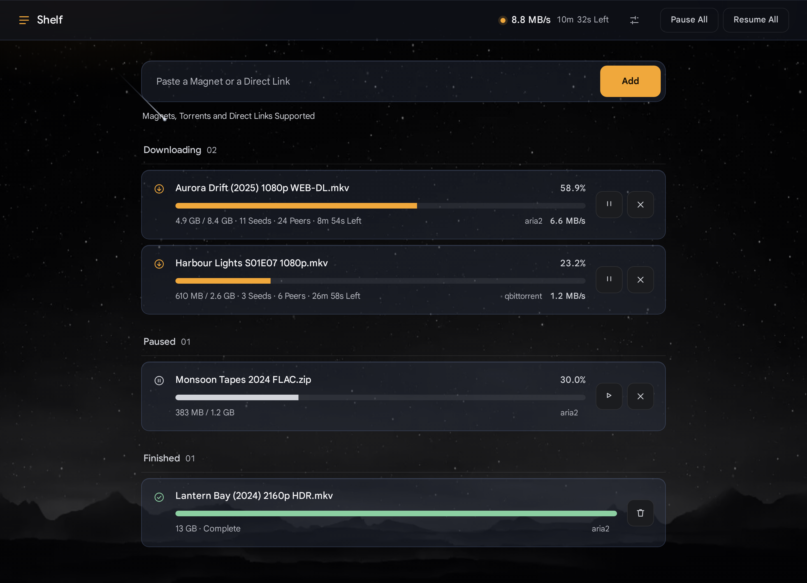

# Shelf

A download station for a small home server. Paste a magnet, a torrent URL or a
direct link on one page; aria2 and qBittorrent share the same live queue. The
page sleeps when nobody is looking, so it costs nothing between visits.



## Why it exists

qBittorrent's WebUI handles torrents and aria2 has no interface at all. Shelf is
the single front end for both: one field to add a link, one queue, one set of
pause/resume/delete controls, and a settings page for the download folder.

- One page, no build step, no framework, no external requests at runtime
- Live updates over server-sent events, one snapshot per second
- Deleting a transfer removes its files, and only inside the download folder
- systemd socket activation: the process starts on the first request and exits
  after 15 idle minutes
- Samba share, optional Stremio addon, and firewall rules from the same script
- Guided setup with safe defaults, plus flags for scripted installs

## Quick start

On the server, from this folder:

```bash
sudo ./shelf.sh
```

With a terminal attached it asks four short questions, each with a default, and
shows a summary before touching anything:

```
Shelf setup  press Enter to accept the default in brackets

  Download folder [/media/Movies_and_Shows]:
  Page port [5000]:
  Share the download folder over Samba (y/n) [y]:
  Install the Stremio addon (y/n) [n]:
  Open firewall ports (y/n) [y]:
```

Setup then installs aria2 and Python, builds the environment, writes
`~/.config/aria2/aria2.conf`, installs the systemd units, creates the Samba
share, optionally installs the Stremio addon, opens the firewall when one is
active, and starts everything.

For scripted installs every question is a flag, and `--yes` accepts all
defaults without asking:

```bash
sudo ./shelf.sh --yes
sudo ./shelf.sh --with-stremio --dir /srv/media --name Media --write --no-firewall
```

```
page         http://192.168.1.11:5000
downloads    /media/Movies_and_Shows
samba        smb://192.168.1.11/Movies_and_Shows
services     aria2.service=active shelf.socket=active shelf.service=active
```

Other actions:

```bash
./shelf.sh --status            # what is running, where to reach it
./shelf.sh --start | --stop | --restart
./shelf.sh --logs [--follow]
sudo ./shelf.sh --uninstall    # units and Samba share, keeps files
```

Setup flags: `--dir PATH`, `--share PATH`, `--name NAME`, `--write`,
`--with-stremio`, `--addon-port PORT`, `--tmdb-key KEY`, `--port PORT`,
`--idle SECONDS`, `--no-samba`, `--no-stremio`, `--no-firewall`, `--dry-run`,
`--yes`. `--help` lists them all.

## Settings page

`/settings` changes the download folder, the number of concurrent downloads, and
the speed limit. Values are applied to the running daemon through
`aria2.changeGlobalOption` and written back to `aria2.conf` without touching any
other line, so comments and unrelated options survive.

## Stremio addon

`stremio-addon/` turns the same library into a Stremio catalog. Install it with
the guided setup or `sudo ./shelf.sh --with-stremio`; it serves
`http://<host>:7020/manifest.json`, which is the URL you add inside Stremio.

The addon reads the library from the download folder, stores nothing separately,
and accepts an optional TMDB key for posters (`--tmdb-key`, kept in
`~/.config/shelf/tmdb.env`). It sleeps on its own idle timer and runs from
`stremio-addon/.venv`, so the repository is the only copy of the code.

## Screenshots

| Desktop | Phone |
|---|---|
|  |  |

Both are generated by `tools/screenshots.py`, which answers `/api/*` with
invented demo data, so a real library never appears in the repository.

## How it is put together

```
stremio-addon/    optional Stremio addon, installed by --with-stremio
shelf/
  config.py       paths, aria2 secret, idle timer
  aria2.py        JSON-RPC client, transfer shaping, safe deletes
  qbittorrent.py  optional qBittorrent client, merged into the same queue
  settings.py     validation and persistence for the settings page
  web.py          routes, event stream, idle watchdog
static/           page, settings page, fonts, wallpaper
deploy/           units and installer used before shelf.sh existed
tests/            shaping, API, settings and qBittorrent tests
shelf.sh          install, start, stop, status, logs, uninstall
```

Transfers carry a `source` field (`aria2` or `qbittorrent`) and ids prefixed
with `qb:` for the second engine. When no qBittorrent environment variables are
set, the bridge is inert and the page behaves exactly as before.

## Development

```bash
python3 -m venv .venv && .venv/bin/pip install -e '.[dev]'
.venv/bin/python -m shelf      # http://127.0.0.1:5000
.venv/bin/pytest
```

## API

| Method | Path | Purpose |
|---|---|---|
| GET | `/api/state` | snapshot with summary and per-source status |
| GET | `/api/events` | server-sent events, one per second |
| POST | `/api/add` | `{"url": "..."}`, spaces split into several links |
| POST | `/api/action` | `{"gid": "...", "action": "pause\|resume\|cancel\|delete\|remove"}` |
| POST | `/api/all/pause` `/api/all/resume` | every engine at once |
| GET/PUT | `/api/settings` | read or change folder, concurrency, speed limit |

`cancel` and `delete` stop the transfer and remove its files. `remove` clears a
finished entry and only deletes leftovers when the entry had failed.

## Configuration

| Variable | Meaning |
|---|---|
| `SHELF_QB_URL`, `SHELF_QB_USER`, `SHELF_QB_PASS` | enable the qBittorrent bridge |
| `SHELF_IDLE_SECONDS` | idle time before the page process exits |
| `SHELF_ARIA2_CONF` | aria2 config location, defaults to `~/.config/aria2/aria2.conf` |

Secrets belong in `.env` next to the repository, which is ignored by git. The
aria2 RPC stays on loopback; the page has no login and is meant for a trusted
LAN.

## Design notes

The visual direction is documented in [DESIGN.md](DESIGN.md): graphite control
room, amber signal, frosted glass over the owner's starfield photograph, Google
Sans for text, icons instead of status words, and six CSS-only shooting stars
that respect `prefers-reduced-motion`.

## Licence

Personal project, no licence granted for redistribution. Google Sans is loaded
from Google's font CDN and self-hosted for private use only; a public deployment
needs a licensed substitute.
